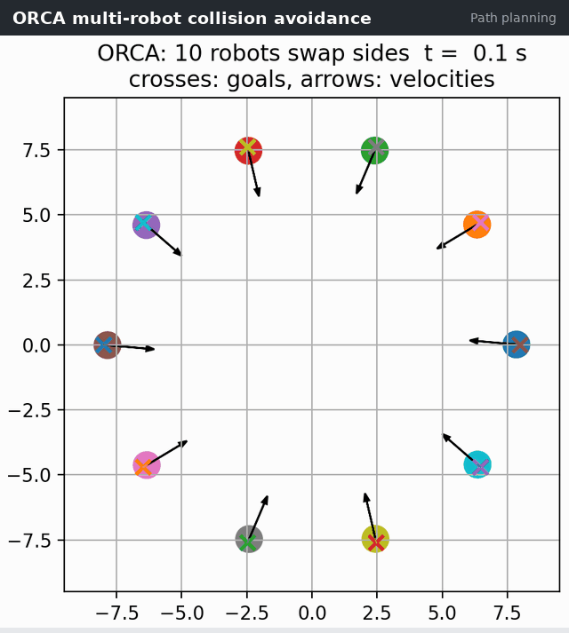
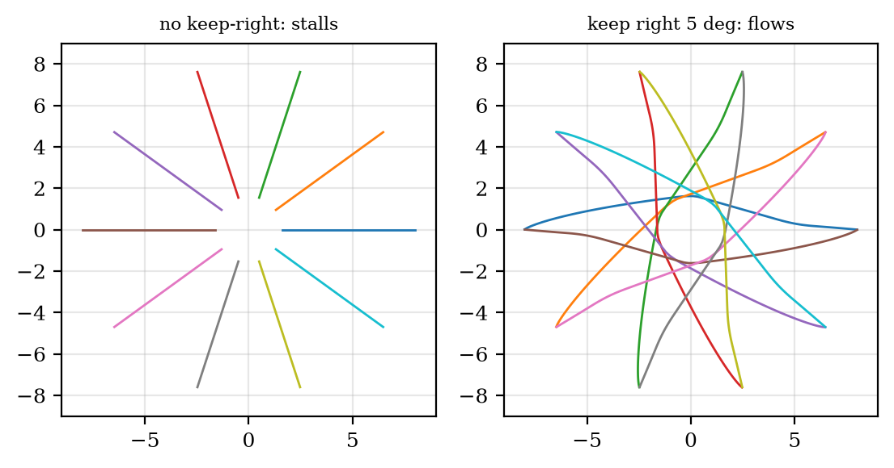

# ORCA: Optimal Reciprocal Collision Avoidance

[](https://github.com/robofan45/orca-collision-avoidance/actions/workflows/ci.yml)

[](LICENSE)
[](docs/report.pdf)

Ten robots swap sides of a circle without communicating: each one solves a tiny linear program over the half-planes of velocities that keep it clear of every neighbour, with both robots of a pair sharing the avoidance. Follows the RVO2 reference implementation.

<p align="center">
  
</p>

## Results

| Measure | Result |
|---|---|
| Ten robots swap sides in | 11.8 s (alone: 10.7 s) |
| Closest approach between two robots | 1.000025 m (contact at 1 m) |
| Reciprocity check: random velocity pairs, closest approach | 16,535 pairs, ≥ 1.005 m |
| Without the keep-right rule | the crowd stalls in a ring |
| Crowd size 4 / 16 / 24 robots | 10.8 s / 14.2 s / jams |
| One step for ten robots | 1.1 ms |

Every number above is measured by [`scripts/make_figures.py`](scripts/make_figures.py), which also writes [`docs/results.json`](docs/results.json) and the figures of the report.

## How it works

For every neighbour $B$, robot $A$ computes the smallest change $u$ of their relative velocity that avoids a collision within $\tau=3$ s, takes half of it, and keeps the half-plane of velocities

```math
\mathrm{ORCA}^\tau_{A|B}=\big\{\,v \;\big|\; \big(v-(v_A+\tfrac12 u)\big)\cdot n\ge 0\,\big\}.
```

It then picks the velocity closest to its preferred one inside all half-planes and its speed limit, a two-dimensional linear program solved incrementally. If both robots of a pair choose from their half-planes, they cannot collide within $\tau$.

Perfect symmetry is ORCA's blind spot: every robot's problem is symmetric about its own line to the goal, so no robot steps aside and the crowd stalls. Turning every preferred velocity a few degrees to the right breaks the tie, and the crowd flows like traffic in a roundabout.

<p align="center">
  <br>
  <em>Without the keep-right rule the robots stall in a ring (left); keeping right by 5° they flow around the centre (right).</em>
</p>

## Quick start

```bash
git clone https://github.com/robofan45/orca-collision-avoidance.git
cd orca-collision-avoidance
python -m pip install -e .
python -m orca_collision_avoidance          # runs the animated demo
```

Requires Python 3.11 or newer; the only dependencies are NumPy and Matplotlib.

## Tests and reproducibility

```bash
python -m pip install -r requirements-dev.txt   # pinned versions, as in CI
pytest                                          # 6 tests
ruff check . && mypy src                        # lint and type checks
python scripts/make_figures.py                  # regenerate docs/figures and docs/results.json
```

CI runs the tests, Ruff and mypy on Linux, macOS and Windows with Python 3.13 and 3.14.

## Report

**Optimal Reciprocal Collision Avoidance for Robot Crowds: Implementation, Verification of Reciprocity and the Symmetric Deadlock** — an IEEE-style technical report (9 pages) covering the problem, the method, the implementation, the experiments and their limitations, with a full bibliography.

- [`docs/report.pdf`](docs/report.pdf) — read it on GitHub
- [`docs/report.docx`](docs/report.docx) — Word source, with native equations

## Repository layout

```text
orca-collision-avoidance/
├── src/orca_collision_avoidance/   the algorithm and the animated demo
├── tests/                          pytest suite
├── scripts/make_figures.py         figures and numbers of the report
├── docs/                           report (PDF and Word), figures, results.json
├── assets/demo.gif                 the animation above
└── pyproject.toml                  package metadata
```

## Citation

If you use this code, please cite it. GitHub's **Cite this repository** button reads [`CITATION.cff`](CITATION.cff); in BibTeX:

```bibtex
@software{trivedi2026orca,
  author = {Trivedi, Mahim},
  title  = {ORCA: Optimal Reciprocal Collision Avoidance},
  year   = {2026},
  url    = {https://github.com/robofan45/orca-collision-avoidance}
}
```

## Related projects

This project is one of seven standalone algorithm projects from the [Python Robotics Projects](https://github.com/robofan45/Python-Robotics-Projects) collection:

- [MPPI Control for Car-Like Robots](https://github.com/robofan45/mppi-control)
- [iLQR Trajectory Optimization](https://github.com/robofan45/ilqr-trajectory-optimization)
- [Control Barrier Function Safety Filter](https://github.com/robofan45/cbf-safety-filter)
- [Augmented Monte Carlo Localization](https://github.com/robofan45/monte-carlo-localization)
- [Interacting Multiple Model (IMM) Filter](https://github.com/robofan45/imm-filter)
- [Multi-Object Tracking](https://github.com/robofan45/multi-object-tracking)

## License

[MIT](LICENSE) © 2026 Mahim Trivedi. The project grew out of [PythonRobotics](https://github.com/AtsushiSakai/PythonRobotics) by Atsushi Sakai and contributors, also MIT-licensed.
